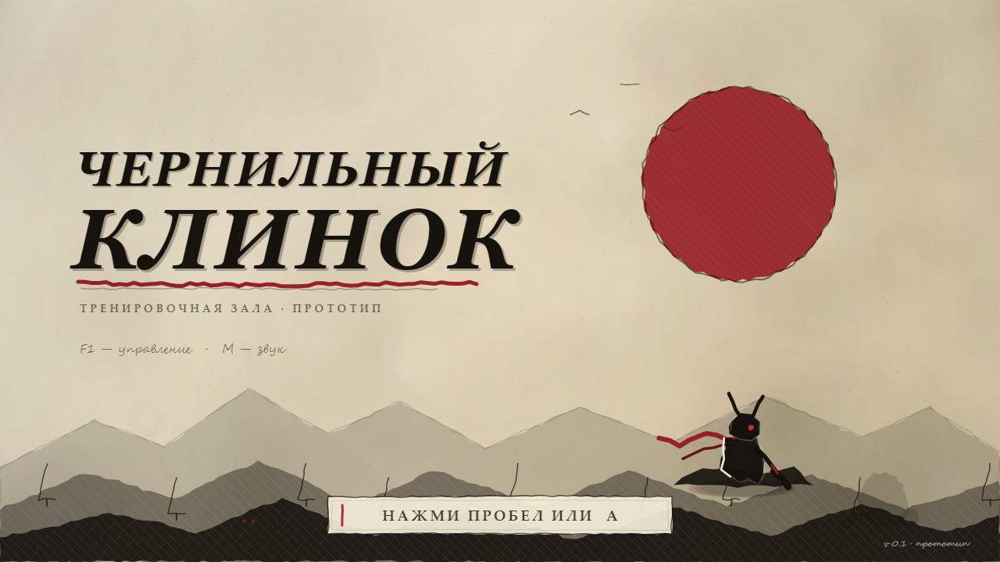
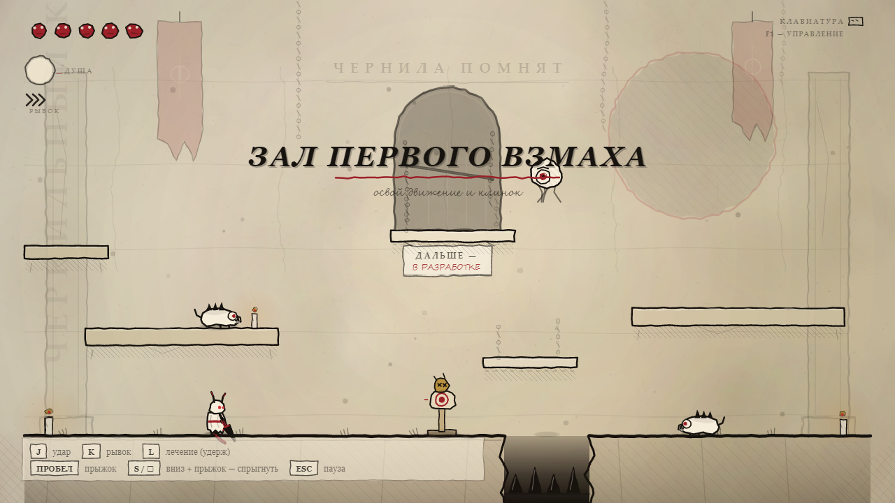
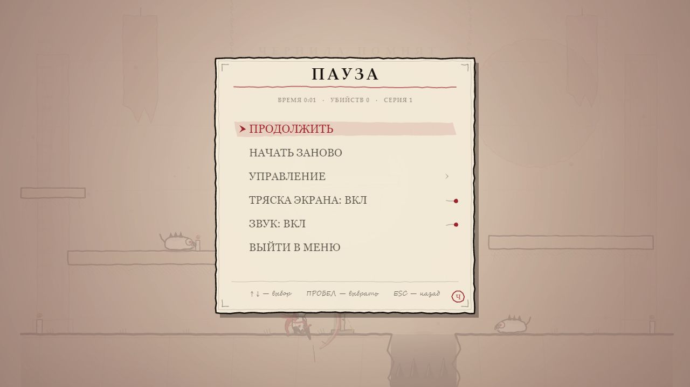
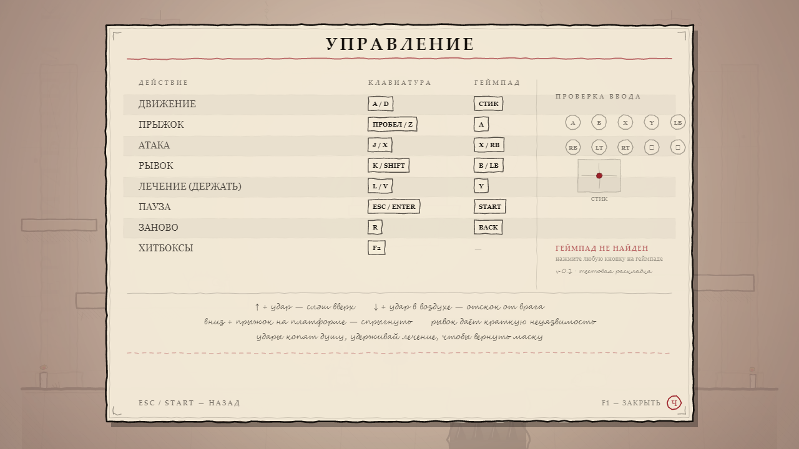
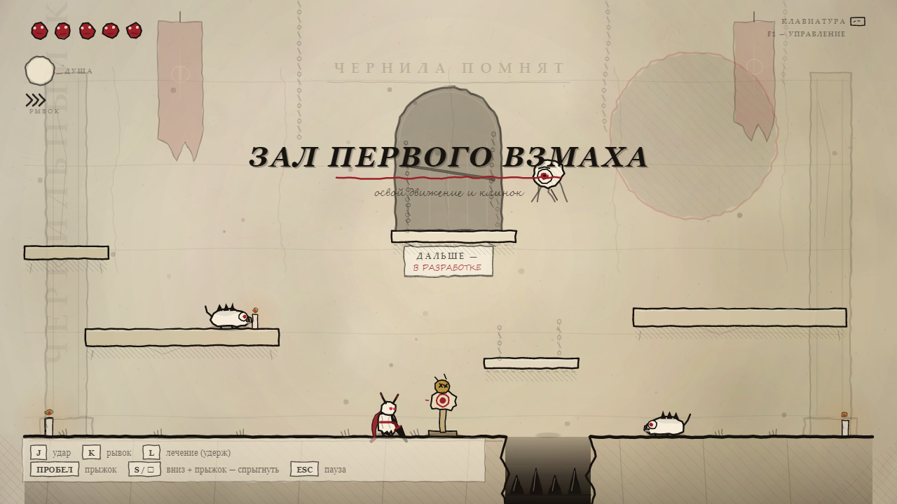
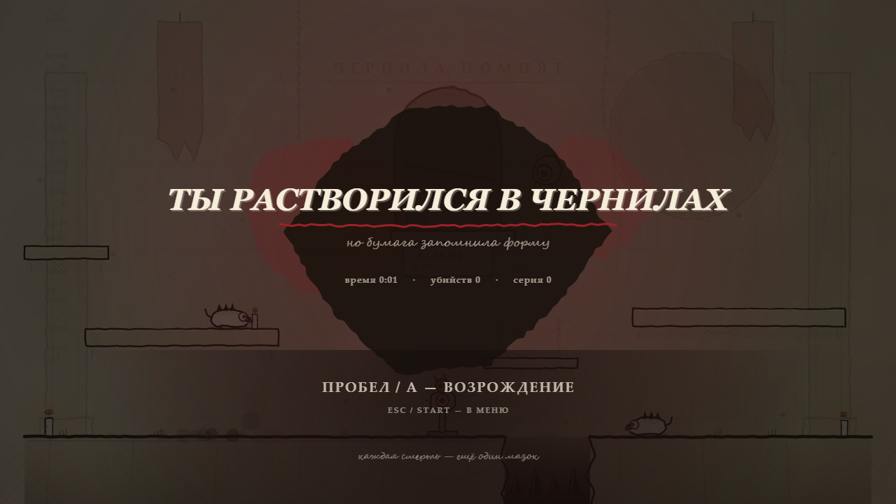

# Чернильный клинок

**Godot 4 · Windows и Android · тестовая зала · v0.2**

Хардкорный экшн-рогалик в рисованной чернильной стилистике: бумага, туши,
кровавые акценты, быстрый бой. Интерфейс переводится вручную: сейчас есть
русский и английский, язык переключается в настройках. Это не полная игра, а
**одна тестовая комната**, собранная для утверждения визуала, управления и
ощущения боя перед производством уровней.

[**Скачать сборку для Windows**](https://github.com/Zalkars/ink-blade/releases/latest) ·
[Все скриншоты](docs/screenshots)



## Содержание

- [Версии](#версии)
- [Установка и запуск](#установка-и-запуск)
- [Управление](#управление)
- [Локализация](#локализация)
- [Что есть в тестовой зале](#что-есть-в-тестовой-зале)
- [Скриншоты](#скриншоты)
- [Технические детали](#технические-детали)
- [Сборка из исходников](#сборка-из-исходников)
- [Структура репозитория](#структура-репозитория)
- [Известные ограничения](#известные-ограничения)

## Версии

- **v0.2 — Godot 4** (текущая): игра перенесена на Godot 4 и GDScript. Одна
  кодовая база собирается под Windows и Android; в релизах публикуется
  Windows-сборка. Релиз: [`v0.2.0-godot`](https://github.com/Zalkars/ink-blade/releases/tag/v0.2.0-godot).
- **v0.1 — native C#** (заморожена): исходный прототип на C#/WinForms/SkiaSharp.
  Остаётся эталоном поведения и лежит в `native/`. Релиз:
  [`v0.1.0`](https://github.com/Zalkars/ink-blade/releases/tag/v0.1.0).

## Установка и запуск

### Готовый билд

1. Откройте [Releases](https://github.com/Zalkars/ink-blade/releases/latest).
2. Скачайте `InkBlade-Godot-win-x64.zip` (~37 МБ).
3. Распакуйте архив в любую папку.
4. Запустите `InkBlade-Windows.exe`.

Устанавливать .NET, Godot и другие зависимости не нужно: ресурсы игры упакованы
внутрь exe. Достаточно одного файла.

**Требования:**

- Windows 10 2004+ или Windows 11, x64;
- видеокарта с OpenGL 3.2+ (рендерер Godot GL Compatibility).

Если Windows SmartScreen предупреждает о неизвестном издателе, нажмите
«Подробнее» → «Выполнить в любом случае». Это локальная тестовая сборка без
цифровой подписи.

### Быстрый старт

- На титульном экране: `Пробел` / `Enter` / `A` на геймпаде.
- `F1` — управление.
- `Esc` — пауза и настройки (работает и с титульного экрана).
- `F11` — полный экран.

## Управление

| Действие | Клавиатура | Геймпад |
|---|---|---|
| Движение | `A` / `D` или стрелки | левый стик / D-pad |
| Прыжок | `Пробел` / `Z` | `A` |
| Атака | `J` / `X` | `X` / `RB` |
| Рывок | `K` / `C` / `Shift` | `B` / `LB` |
| Лечение (удерживать) | `L` / `V` | `Y` |
| Пауза и настройки | `Esc` | `Start` |
| Начать заново | `R` | `Back` |
| Управление | `F1` | — |
| Хитбоксы / FPS | `F2` или `F` | — |
| Полный экран | `F11` | — |
| Скриншот | `F12` | — |
| Звук вкл/выкл | `M` | — |

`Enter` в меню работает как подтверждение, а не как пауза. На титульном экране
`Esc` открывает настройки: там переключаются язык, звук, тряска экрана и
остальные параметры.

## Локализация

Весь текст интерфейса лежит в JSON-файлах `godot/locale/`. Сейчас есть русский
(`ru.json`) и английский (`en.json`). Язык переключается в настройках (пункт
«Язык» / «Language», первая строка) и сохраняется в `user://settings.cfg`,
поэтому выбор остаётся между запусками.

Чтобы добавить новый язык, менять код не нужно:

1. Скопируйте `godot/locale/ru.json` в `godot/locale/<код>.json`
   (например `de.json`, `fr.json`, `ja.json`).
2. Переведите значения в блоке `"strings"`. Ключи трогать нельзя — по ним
   игра находит текст.
3. В начале файла укажите `"name"` — название языка на нём самом (оно видно в
   настройках) и `"order"` — порядок в переключателе (0 — первый).
4. Запустите игру заново: файл подхватится автоматически, в том числе в
   экспортированной сборке (пресеты экспорта уже включают `locale/*.json`).

Если ключ в переводе пропущен, показывается русский вариант, а в отладочной
сборке печатается предупреждение со списком недостающих ключей. Полноту
перевода можно проверить методом `L10N.audit()`.

## Что есть в тестовой зале

- Полноценное перемещение, прыжки, рывок с краткой неуязвимостью.
- Лёгкая и тяжёлая атака, отскок от врага в воздухе, дефлект снарядов.
- Лечение за накопленную душу, комбо и хитстоп.
- Манекен для проверки урона, два наземных врага и летающий часовой.
- Яма с шипами, односторонние платформы и спрыгивание с них.
- HUD: маски здоровья, душа, серия, подсказки, стартовый баннер.
- Пауза, экран управления, экран смерти и возрождение.
- Настройки языка, тряски экрана и звука с титульного экрана и из паузы.
- Процедурная бумага, чернильные штрихи, свечи, пыль и виньетка.
- Полностью синтезированный звук без внешних аудиофайлов.
- Тач-слой (плавающий стик и кнопки A/X/B/Y/Ⅱ) — задел под Android-сборку.

## Скриншоты

| Титул | Бой |
|---|---|
|  |  |

| Пауза | Управление |
|---|---|
|  |  |

| Арена | Смерть |
|---|---|
|  |  |

Полный набор кадров: [`docs/screenshots`](docs/screenshots).
Карточки для магазина: [`docs/rustore`](docs/rustore).

> На кадре экрана управления геймпад не был подключён. При подключённом
> контроллере там отображается статус и нажатия кнопок.

## Технические детали

**Godot-версия (v0.2):**

- Godot 4.5+ (сборка проверена на 4.7.2), GDScript, рендерер GL Compatibility.
- Внутреннее разрешение 1280×720; на Android — `sensor_landscape`, холст
  заполняет весь экран.
- Вся отрисовка — через `CanvasItem._draw` (`InkR`), аналог `Ink.cs`.
- Бумага, сцена и титульный экран запекаются в текстуры через `SubViewport`,
  чтобы держать стабильные ~60 FPS в бою.
- Звук синтезируется в реальном времени через `AudioStreamGenerator`
  (22050 Гц), внешних аудиофайлов нет.
- Ввод — собственный слой `CTL` (клавиатура, геймпад, мультитач) вместо
  XInput и Input Map.
- Локализация — автолоад `L10N` (`scripts/i18n.gd`) и JSON-словари в
  `locale/`; новый язык добавляется файлом, без правок кода. Статические слои
  с текстом (зал и титул) перезапекаются при смене языка.

**Native-версия (v0.1):**

- C# / .NET 9, WinForms, SkiaSharp (OpenGL), NAudio, XInput.
- При отсутствии OpenGL включается более медленный CPU-рендер SkiaSharp.

## Сборка из исходников

### Godot-версия

Нужен Godot 4.5+ с шаблонами экспорта для Windows.

```powershell
godot --headless --path godot --import
godot --headless --path godot --export-release "Windows Desktop" builds\InkBlade-Windows.exe
```

Или откройте папку `godot/` в редакторе, запустите `main.tscn` и используйте
пресет экспорта «Windows Desktop». Результат по умолчанию пишется в `builds/`
(каталог не коммитится).

Android-пресет тоже лежит в `godot/export_presets.cfg`, но для APK нужны
Android SDK, JDK и Android-шаблоны экспорта. Android-сборка ведётся отдельно и
в релизы этого репозитория не выкладывается.

### Native-версия (v0.1)

Нужен .NET 9 SDK.

```powershell
cd native\InkBlade
dotnet build -c Release
dotnet publish -c Release -r win-x64 --self-contained true `
  -o ..\..\dist\InkBlade-win-x64
```

Полезные аргументы для отладки native-сборки:

```text
--noaudio          отключить звук
--noshots          не сохранять скриншоты в автотесте
--autotest         прогнать сценарий и сделать набор кадров
--out <папка>      куда сохранять кадры
```

## Структура репозитория

```text
godot/                  Godot 4 проект (основная версия)
  project.godot         настройки проекта, автолоады L10N, CTL и SND
  main.tscn             единственная сцена
  scripts/              InkR, мир, игрок, враги, HUD, FX, ввод, звук, i18n
  locale/               переводы интерфейса (ru.json, en.json)
  assets/               иконки
  export_presets.cfg    пресеты Windows и Android
native/InkBlade/        native-версия v0.1 (C#)
  Core/                 ввод, звук, чернильный рендер, утилиты
  Game/                 игровой цикл, игрок, враги, HUD, мир, эффекты
  GameWindow.cs         окно, OpenGL/CPU-рендер, скриншоты
docs/screenshots/       кадры тестовой залы
docs/rustore/           карточки для магазина и скрипт их генерации
PORTING_ANDROID.md      решение по общему Godot-проекту и этапы порта
```

`dist/`, `snapshots/`, `builds/` и готовые архивы не коммитятся — бинарные
сборки публикуются в [Releases](https://github.com/Zalkars/ink-blade/releases/latest).

## Известные ограничения

- Только одна тестовая комната; переходов между уровнями нет.
- Переназначение клавиш и настройки графики — в следующих версиях; сейчас
  доступны язык, тряска экрана, звук и сенсорные кнопки.
- Android-сборка не входит в релизы и поддерживается отдельно.
- Баланс, количество врагов и контент зала — черновые.
- Это прототип для утверждения, а не финальная игра.
