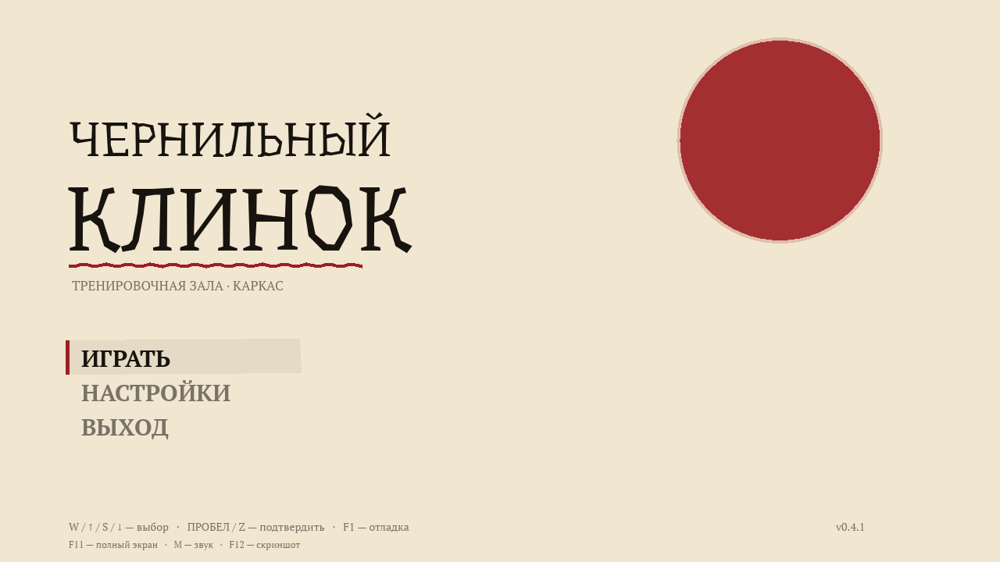
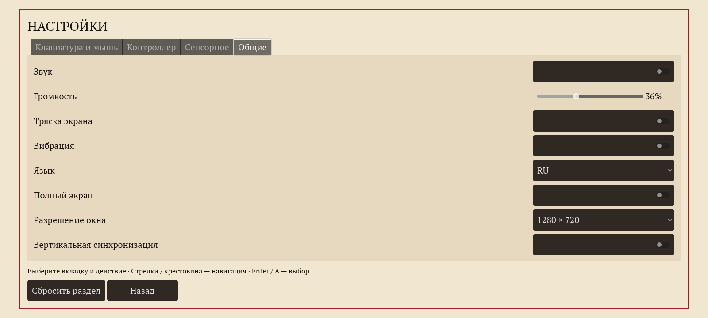
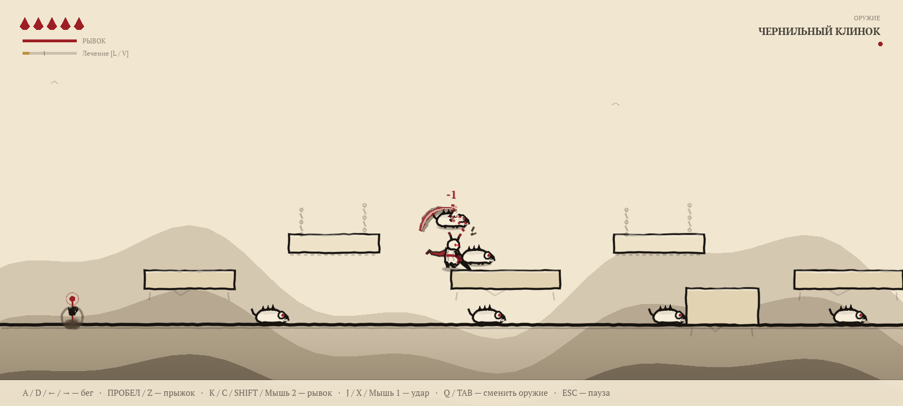
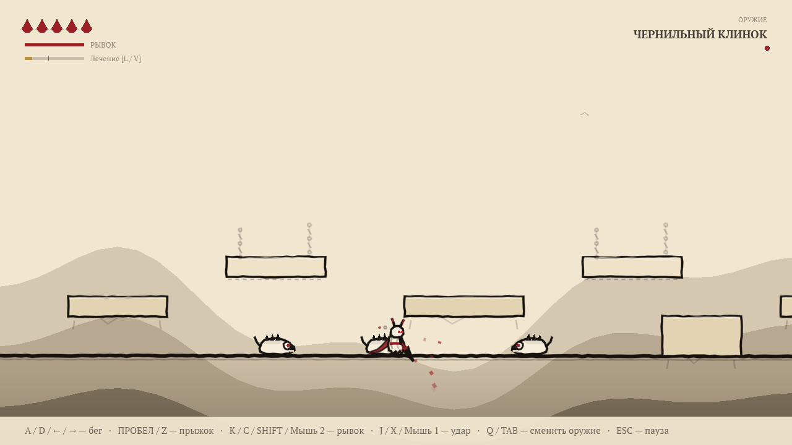
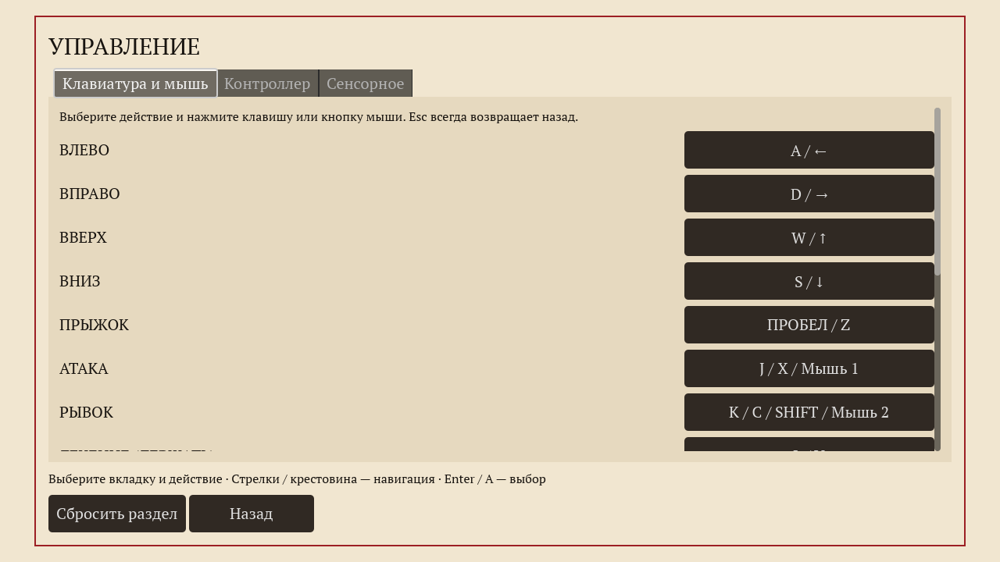
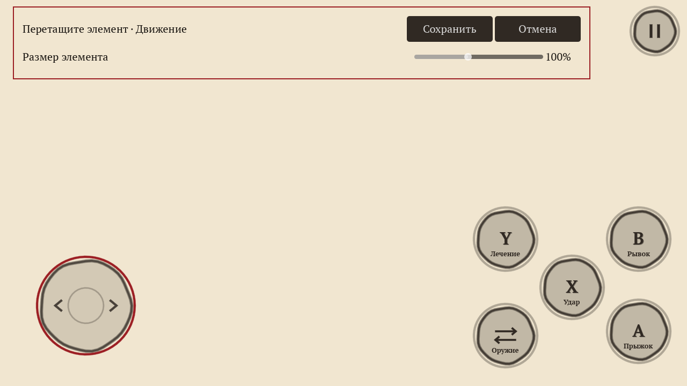

# Чернильный клинок · Ink Blade

**v0.4.1 · Godot 4.5.1 · Windows и Android**

Экшн-платформер в рисованной чернильной стилистике: бумага, тушь,
быстрый бой, рывки и лечение за накопленную душу. Текущая версия —
вертикальный срез с четырьмя зонами первого уровня, чекпоинтами,
диалогом, двумя видами оружия и боссом Хранителем.

[**Скачать v0.4.1 для Windows и Android**](https://github.com/Zalkars/ink-blade/releases/tag/v0.4.1) ·
[История изменений](CHANGELOG.md) · [Технический бриф](docs/tech-brief.md)



## Исправления в 0.4.1

Ход работы и проверки — в [FIX_PLAN.md](FIX_PLAN.md). В версии 0.4.1 восстановлены
дуги и направленные атаки из 0.2, эффекты урона и возрождения, общие настройки
(звук, громкость, тряска, вибрация, язык и экран). Исправлены атака от любого
касания, фон заставки в безопасных отступах и окрашивание рельефа чернилами.

Для удара вверх удерживайте W / стрелку вверх либо отклоните стик / крестовину
вверх и нажмите атаку. В воздухе можно аналогично ударить вниз.





## Что нового в 0.4.0

- Настройки управления доступны из главного меню и паузы.
- Переназначение клавиш, кнопок мыши, кнопок и триггеров контроллера.
- Движение на контроллере: стик, крестовина или оба; настройка мёртвой зоны.
- Сенсорное управление: плавающий или фиксированный стик, либо крестовина.
  Мультитач позволяет одновременно двигаться, прыгать и атаковать.
- Редактор сенсорной раскладки: перетаскивание каждого элемента, индивидуальный
  размер 65–150%, непрозрачность 25–100%, сохранение и отмена изменений.
- Кнопки учитывают безопасную область телефона; широкий экран расширяет обзор.
- Обновлены рисунок персонажей и платформ, бой, снаряды и лечение.
- Обе платформы собираются из одного проекта; Android APK подписан релизным ключом.



## Скачать и запустить

### Windows

1. Скачайте `InkBlade-0.4.1-windows-x64.zip` со [страницы релиза](https://github.com/Zalkars/ink-blade/releases/tag/v0.4.1).
2. Распакуйте архив и запустите `InkBlade-Windows.exe`.

Godot и .NET устанавливать не нужно: ресурсы встроены в EXE.
Нужны 64-разрядная Windows 10/11 и видеокарта с поддержкой OpenGL 3.3.
EXE не имеет подписи издателя Windows.

### Android

1. Скачайте `InkBlade-0.4.1-android.apk` с той же страницы релиза.
2. Разрешите установку из выбранного браузера или файлового менеджера и установите APK.
3. Запустите «Чернильный клинок». Игра работает в горизонтальной ориентации.

Требуется Android 7.0 или новее. APK содержит ARMv7, ARM64 и x86_64. Идентификатор приложения —
`org.inkblade.game`, версия — `0.4.1`, код версии — `40001`.
Для обновления поверх старого APK подпись старой установки должна совпадать;
при несовпадении Android отклонит обновление. Удаление приложения удаляет локальные сохранения.
Интернет игре не требуется. В релизе также опубликован `SHA256SUMS.txt`.

## Управление по умолчанию

| Действие | Клавиатура / мышь | Контроллер |
|---|---|---|
| Движение | A / D, стрелки | Левый стик / крестовина |
| Прыжок | Пробел / Z | A |
| Атака | J / X / левая кнопка мыши | X / RB |
| Рывок | K / C / Shift / правая кнопка мыши | B / LB |
| Лечение: удерживать | L / V | Y |
| Смена оружия | Q / Tab | RT |
| Пауза | Esc | Start |
| Назад в меню | Esc | B / Start |
| Начать заново | R | Back |
| Отладочный HUD | F1 / F2 / F | — |
| Полный экран | F11 | — |
| Скриншот | F12 | — |
| Звук | M | — |

В меню можно нажимать мышью или пальцем; клавиатура и контроллер поддерживают
навигацию. Enter / A подтверждают выбор. На телефоне названия действий
подписаны на сенсорных кнопках. Лечение требует души и доступно на земле;
кисть открывается после разговора с Переписчиком.

### Настройка управления

Откройте **«Настройки»** в главном меню или паузе.

- **Клавиатура и мышь:** выберите действие и нажмите нужную клавишу или кнопку
  мыши. Esc отменяет захват, ожидание заканчивается через 8 секунд.
  При конфликте клавиша перераспределяется; недопустимое назначение отклоняется.
- **Контроллер:** назначайте кнопки и триггеры; выбирайте способ движения
  и мёртвую зону 10–60%. Крестовина остаётся за движением.
- **Сенсорное:** выбирайте тип движения и непрозрачность. Нажмите
  **«Настроить расположение и размер»**, выберите элемент, перетащите его
  и настройте размер ползунком. **«Сохранить»** применяет раскладку,
  **«Отмена»** возвращает исходную. Перекрывающиеся элементы сохранить нельзя.
- **«Сбросить раздел»** возвращает исходные значения только текущей вкладки.

Настройки записываются в `user://settings.cfg` и восстанавливаются при запуске.
Редактор сенсорных кнопок доступен на ПК для предпросмотра; для игры с ним
на ПК можно передать `--touch`. Полный экран переключается F11 и запоминается.





## Сохранения и языки

Игра сохраняет чекпоинт, состояние уровня, открытое оружие и прогресс.
«Продолжить» появляется при наличии незавершённого автосохранения.
Сохранения локальные; облачной синхронизации нет.

Строки русского и английского интерфейса лежат в `godot/locale/`.
Текущая локаль хранится в `settings.cfg`, секция `[locale]`, ключ `lang`
(`ru` или `en`). На Windows каталог пользователя обычно находится в
`%APPDATA%/Godot/app_userdata/Ink Blade/`.

## Сборка из исходников

Общий проект находится в `godot/`, главная сцена —
`scenes/flow/game_flow.tscn`. Нужны **Godot 4.5.1 standard** и соответствующие
export templates. C#-версия в `native/` сохранена как исходный прототип.

```powershell
Godot --headless --path godot --editor --quit
Godot --headless --path godot --export-release "Windows Desktop" ../builds/InkBlade-Windows.exe
Godot --headless --path godot --export-release "Android" ../builds/InkBlade-0.4.1-android.apk
```

Для Android нужны JDK 17 и Android SDK, настроенные в Editor Settings.
Релизную подпись задавайте локально через Godot Export Credentials либо
переменные `GODOT_ANDROID_KEYSTORE_RELEASE_PATH`,
`GODOT_ANDROID_KEYSTORE_RELEASE_USER`, `GODOT_ANDROID_KEYSTORE_RELEASE_PASSWORD`.
Ключи и пароли в репозиторий не входят. Пресеты экспорта —
`godot/export_presets.cfg`; тестовые сцены исключены из игровых сборок.

## Проверки

```powershell
Godot --headless --path godot tests/smoke.tscn
Godot --headless --path godot tests/combat.tscn
Godot --headless --path godot tests/fixes.tscn
Godot --headless --path godot tests/controls.tscn
Godot --headless --path godot tests/mobile.tscn -- --touch
```

Smoke-тест использует отдельные тестовые сохранения: запускайте проверки
с отдельным пользовательским каталогом Godot. Тест настроек временно меняет
`settings.cfg` и затем восстанавливает его. Без `--headless` он сохраняет
снимки экранов настроек в `builds/controls-review/`.

## Структура

```text
godot/
  scenes/flow/         Главная сцена
  scenes/actors/       Игрок, враги и снаряды
  content/             Уровни, оружие, враги, диалоги и катсцены
  scripts/core/        Состояния игры и камера
  scripts/ui/          Меню, настройки, сенсорное управление, HUD
  scripts/visuals/     Рисование персонажей
  scripts/systems/     Сохранения
  locale/              Русские и английские строки
  tests/               Автоматические проверки
native/                Исходный прототип C#
docs/                  Бриф, планы и материалы проекта
```

## Ограничения

Это вертикальный срез, а не завершённая кампания. Физический геймпад,
производительность и управление на реальном Android-устройстве требуют
дополнительной проверки. Автоматические тесты ввода не заменяют такую проверку.
Релиз APK предназначен для прямой установки; публикация в магазине — отдельный шаг.

## Предыдущие релизы

- [v0.4.0 — настройки управления и Android](https://github.com/Zalkars/ink-blade/releases/tag/v0.4.0)

- [v0.3.1 — исправления управления Windows](https://github.com/Zalkars/ink-blade/releases/tag/v0.3.1)
- [v0.3.0 — вертикальный срез](https://github.com/Zalkars/ink-blade/releases/tag/v0.3.0-slice)
- [v0.2.0 — Godot-порт](https://github.com/Zalkars/ink-blade/releases/tag/v0.2.0-godot)
- [v0.1.0 — исходный прототип](https://github.com/Zalkars/ink-blade/releases/tag/v0.1.0)
